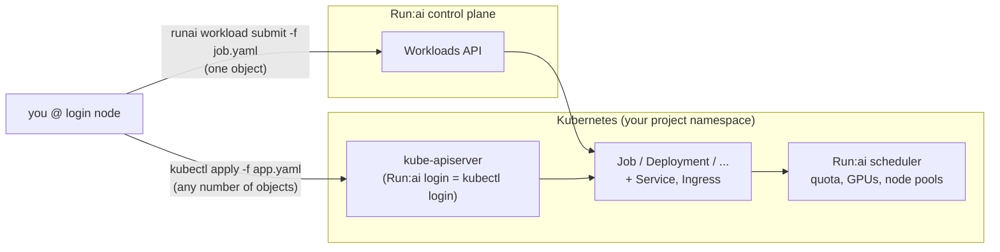

# Run:ai from the command line: writing your own workload YAML

A how-to for researchers who want to go beyond the Run:ai UI: write a
Kubernetes manifest, submit it to your project, and control GPUs, CPUs,
storage and networking yourself. Every example in this guide was submitted
on this cluster as a regular user; the files are on the login node in
`/usr/local/share/runai/examples` (source: [runai/examples](runai/examples)).

**Site values used below** (change these if you adapt the guide to another
cluster):

| What | Value here |
|---|---|
| Login node (CLI, kubectl, your home) | `ww1` — `ssh <user>@192.168.65.2` |
| Run:ai URL / your login | `https://runai.htd.local`, `<user>@htd.local` |
| Project namespace | `runai-<project>` (e.g. `runai-phys-astro`) |
| Image registry for workloads | `10.10.172.1:5001/workloads/<image>:<tag>` |
| Node pools (GPU types) | `a100` (2 nodes × 2 A100 40 GB), `h100` (1 node × 2 H100 80 GB) |
| Home directories | NFS `/home/<user>`, UID ≥ 5000, GID = your group |
| Ingress hostnames | `<anything>.runai.htd.local` |

> The lab's GPUs are simulated (fake-gpu-operator): scheduling, quotas,
> fractions and `nvidia-smi` output behave like real ones, but nothing runs
> on a GPU. CUDA code will fail; everything else in this guide is real.

---

## Contents

1. [Two ways to submit](#1-two-ways-to-submit)
2. [One-time setup](#2-one-time-setup)
3. [Anatomy of a workload manifest](#3-anatomy-of-a-workload-manifest)
4. [Calling your correct project](#4-calling-your-correct-project)
5. [Calling CPUs and memory](#5-calling-cpus-and-memory)
6. [Calling GPUs](#6-calling-gpus)
7. [Binding your home and other directories](#7-binding-your-home-and-other-directories)
8. [Networking](#8-networking)
9. [Distributed (multi-pod) jobs](#9-distributed-multi-pod-jobs)
10. [Priority and preemption](#10-priority-and-preemption)
11. [Managing workloads](#11-managing-workloads)
12. [Without YAML: CLI flags](#12-without-yaml-cli-flags)
13. [Troubleshooting](#13-troubleshooting)
14. [Notes for administrators](#14-notes-for-administrators)

---

## 1. Two ways to submit



| | `runai workload submit -f file.yaml` | `kubectl apply -f file.yaml` |
|---|---|---|
| Objects per file | **one** (the first document; the rest is ignored) | any number (`---` separated) |
| Good for | single Jobs, Deployments, Pods | anything that also needs a Service, Ingress, ConfigMap or Secret |
| Project | `-p <project>` or your default project | `-n runai-<project>` or your kubectl context |
| Priority / preemptibility | `--priority`, `--preemptibility` flags or labels | labels in the manifest |
| Shows up in the Run:ai UI, counts against quota | yes | yes |

Both paths end in the same place: the workload is scheduled by the Run:ai
scheduler, counted against your project's quota, and listed in the UI and by
`runai workload list`.

---

## 2. One-time setup

Log in to the login node with your cluster account (the password is the same
as for the Run:ai UI):

```bash
ssh <user>@192.168.65.2
```

The first login points the `runai` CLI at this site and creates a
`~/.kube/config` for you. Then:

```bash
# 1. Log in to Run:ai (prompts for your password)
runai login user -u <user>@htd.local
#    or, single sign-on through a browser on your laptop:
#    runai login remote-browser

# 2. See your projects and pick the default one
runai project list
runai project set <project>              # e.g. runai project set phys-astro

# 3. Let kubectl use your Run:ai login (needed once; renews itself)
runai kubeconfig set --bypass-validation
kubectl config set-context --current --namespace=runai-<project>
kubectl auth whoami                      # -> <user>@htd.local, groups [<project>]

# 4. Get the examples, personalised (UID, GID, user name)
mkdir -p ~/runai && cp /usr/local/share/runai/examples/*.yaml ~/runai/ && cd ~/runai
sed -i -e "s/5102/$(id -u)/g" -e "s/5100/$(id -g)/g" -e "s/lperez/$USER/g" *.yaml
```

`runai whoami` shows who you are logged in as; `runai logout` ends the
session. Sessions expire: if a command says the token is expired, run
`runai login` again.

> Ten wrong passwords in a row lock the account for a while (Keycloak
> brute-force protection). Ask an administrator rather than retrying.

---

## 3. Anatomy of a workload manifest

A workload is a standard Kubernetes object. Run:ai adds the scheduling
(scheduler, project queue, node-pool affinity, GPU bookkeeping) when you
submit it, so a minimal manifest is plain Kubernetes:

```yaml
apiVersion: batch/v1
kind: Job                          # what kind of workload (table below)
metadata:
  name: hello-cpu                  # unique in the project; a-z, 0-9, '-', <= 63 chars
spec:
  backoffLimit: 0                  # don't retry a failed run
  ttlSecondsAfterFinished: 3600    # clean up 1 h after it finishes
  template:                        # the pod: everything below is per pod
    metadata:
      labels: {}                   # node pool goes here (section 6)
      annotations: {}              # GPU fractions go here (section 6)
    spec:
      restartPolicy: Never
      securityContext: {}          # who you run as (section 7)
      containers:
        - name: main
          image: 10.10.172.1:5001/workloads/ubuntu:24.04
          command: ["bash", "-c", "echo hello; sleep 20"]
          resources: {}            # CPUs, memory, GPUs (sections 5, 6)
          volumeMounts: []         # home, data, scratch (section 7)
      volumes: []
```

Example: [01-cpu-job.yaml](runai/examples/01-cpu-job.yaml)

```bash
runai workload submit -f 01-cpu-job.yaml
runai workload logs hello-cpu
```

### Which kind to use

Run:ai treats each Kubernetes kind as a workload type with its own defaults:

| Kind | Run:ai category | Default priority | Default preemptibility | Use it for |
|---|---|---|---|---|
| `Job` (batch/v1) | Train | low | **preemptible** | batch runs, training, sweeps — can use idle GPUs beyond your quota |
| `Deployment`, `StatefulSet`, `Pod`, `ReplicaSet` | Deploy | very-high | **non-preemptible** | long-running services, notebooks |
| `CronJob` | Deploy | very-high | non-preemptible | scheduled jobs |

**Non-preemptible workloads must fit inside your project's guaranteed GPU
quota.** A GPU `Deployment` beyond quota stays pending; use a `Job`, or
submit with `--preemptibility preemptible` (section 10).

Distributed kinds (PyTorchJob, MPIJob, RayJob, ...) are known to Run:ai but
need their operator, which is not installed in this cluster; use the Indexed
Job pattern of section 9 instead.

### Images: only local images work

The compute nodes have **no internet access**. Use images from the local
workload registry:

| Image | Reference |
|---|---|
| Ubuntu 24.04 | `10.10.172.1:5001/workloads/ubuntu:24.04` |
| UBI 9 | `10.10.172.1:5001/workloads/ubi9:9.8` |
| Rocky 9 | `10.10.172.1:5001/workloads/rocky:9.8` |
| Alma 9 | `10.10.172.1:5001/workloads/alma:9.8` |
| Jupyter (SciPy) | `10.10.172.1:5001/workloads/jupyter-scipy:2026-10-28` |
| RStudio | `10.10.172.1:5001/workloads/rstudio:4.6.2` |
| code-server | `10.10.172.1:5001/workloads/code-server:4.99.4` |
| Kali | `10.10.172.1:5001/workloads/kali-rolling:2026-10-31` |

`docker.io/library/<image>` references also work for images the
administrators have mirrored, but anything else ends in `ImagePullBackOff`.
Need another image (PyTorch, CUDA, your own)? Ask an administrator to mirror
it (`runai/25-mirror-image.sh <image>`). For the same reason `pip install`
and `apt-get` from the internet fail inside workloads: bake dependencies into
the image or keep a virtualenv/conda environment in your home directory.

---

## 4. Calling your correct project

Every workload belongs to exactly one **project**; the project decides the
quota it is counted against, the node pools it may use, and who can see it.
A project `<p>` is the Kubernetes namespace `runai-<p>`.

| How | `runai workload submit` | `kubectl` |
|---|---|---|
| Default for every command | `runai project set phys-astro` | `kubectl config set-context --current --namespace=runai-phys-astro` |
| Per command | `-p phys-astro` | `-n runai-phys-astro` |
| In the file | `metadata.namespace: runai-phys-astro` (the `-p` flag wins) | `metadata.namespace: runai-phys-astro` |

Rules:

- You can only submit to projects your group has access to; `runai project
  list` shows them, with their GPU quota and current allocation. Submitting
  elsewhere fails with *forbidden*.
- Members of several groups have several projects: always pass `-p`/`-n` in
  scripts instead of relying on the default.
- Leave `namespace` out of files you share, so the same file works in any
  project.

```bash
runai workload submit -f 02-gpu-job.yaml -p phys-astro
kubectl apply -f 06-distributed-job.yaml -n runai-phys-astro
```

---

## 5. Calling CPUs and memory

CPUs and memory are standard Kubernetes `resources` on each container:

```yaml
          resources:
            requests: {cpu: "1", memory: 1Gi}     # reserved for you; used for scheduling
            limits:   {cpu: "2", memory: 2Gi}     # hard ceiling
```

- **requests** decide where the pod fits; the node must have that much free.
  Ask for what you need, not more: unused requests block other users.
- **limits.cpu** throttles (you get at most N cores of time);
  **limits.memory** kills the container with `OOMKilled` when exceeded.
- Units: `500m` = half a core, `2` = 2 cores; `512Mi`, `4Gi`.
- `requests == limits` for both gives the pod "Guaranteed" QoS: it is the
  last to be evicted when a node runs short of memory.
- `nproc` and `os.cpu_count()` inside the container show **all** cores of
  the node, not your limit. Size thread pools explicitly:

  ```yaml
          env:
            - {name: OMP_NUM_THREADS, value: "2"}
            - {name: MKL_NUM_THREADS, value: "2"}
  ```

  The real limit is in `/sys/fs/cgroup/cpu.max` and `memory.max` (example 01
  prints them).
- The lab nodes are small (4 cores, 16 GB each, most of it already taken by
  the platform). Requests above ~1 core / 4 GiB per pod may stay pending.

---

## 6. Calling GPUs

### Whole GPUs

Request GPUs as a container limit:

```yaml
          resources:
            requests: {cpu: "1", memory: 2Gi}
            limits:   {cpu: "1", memory: 2Gi, nvidia.com/gpu: 1}   # 1, 2, ... whole GPUs
```

The container sees only its GPUs (`nvidia-smi` is injected by the NVIDIA
runtime; `RUNAI_NUM_OF_GPUS` holds the count). A pod's GPUs are always on
one node, so the most a single pod can get here is 2.

### Choosing the GPU type (node pool)

GPU types are separate **node pools**. Pick one with a label on the pod
template:

```yaml
  template:
    metadata:
      labels:
        runai/node-pool: h100        # or a100
```

Without the label the scheduler uses any pool of your project (in its
configured order). Example: [02-gpu-job.yaml](runai/examples/02-gpu-job.yaml)

```bash
runai workload submit -f 02-gpu-job.yaml
runai workload describe gpu-job      # "Current Node Pool: h100"
```

### Fractions of a GPU

Run:ai can share one GPU between workloads. Request a fraction with an
**annotation on the pod template**, and no `nvidia.com/gpu` limit:

```yaml
  template:
    metadata:
      annotations:
        gpu-fraction: "0.5"          # half a GPU: compute share and half its memory
        # or instead:
        # gpu-memory: "20000"        # a fixed amount of GPU memory, in MiB
```

- Use `gpu-fraction` **or** `gpu-memory`, never both.
- Only one container per pod gets the fraction (the first, or the one named
  in the annotation `gpu-fraction-container-name`).
- Several fractional GPUs: add `gpu-fraction-num-devices: "2"` (= 2 × 0.5).
- Fractions are ideal for notebooks, debugging and small inference; use whole
  GPUs for training.

Example: [03-fractional-gpu.yaml](runai/examples/03-fractional-gpu.yaml).
`runai workload list` shows `GPU Alloc. 0.50`.

### GPUs and your quota

| Situation | What happens |
|---|---|
| Within your project's quota | scheduled as soon as GPUs are free |
| Above quota, preemptible (`Job`) | runs on idle GPUs ("over quota"); may be stopped when the owner of those GPUs needs them |
| Above quota, non-preemptible (`Deployment`, `Pod`) | stays pending (`NonPreemptibleOverQuota`) |

Check before you submit: `runai project list` (quota and allocation) and
`runai nodepool list`.

---

## 7. Binding your home and other directories

### Run as yourself

Containers run as the image's user (often `root`) unless you say otherwise.
To read and write your NFS home with the right ownership, run as your own
UID/GID (`id -u`, `id -g` on the login node):

```yaml
    spec:
      securityContext:
        runAsUser: 5102              # id -u
        runAsGroup: 5100             # id -g  (your group = your project's group)
        supplementalGroups: [5100]
```

### Your home directory

`/home` on every node is the NFS home of the login node. **Pods that run as
a site user (UID ≥ 5000) get `/home` mounted automatically**; to make it
explicit (or for clarity in shared files), mount it yourself — the cluster
then leaves your pod alone:

```yaml
      containers:
        - name: main
          workingDir: /home/lperez               # start in your home
          env:
            - {name: HOME, value: /home/lperez}  # tools write ~/.cache, ~/.config here
          volumeMounts:
            - {name: home, mountPath: /home}
      volumes:
        - name: home
          hostPath: {path: /home, type: Directory}
```

- Other users' homes are visible but protected by their permissions (700).
- Set `HOME` and `workingDir`: images default to `/root` or their own user's
  home (e.g. `/home/jovyan`), which is hidden under the NFS `/home` and fails
  with `mkdir /home/jovyan: permission denied`.
- To keep the image's own `/home` (e.g. running Jupyter as `jovyan`), don't
  set `runAsUser` ≥ 5000, or add the annotation `home.htd.local/skip: "true"`
  to the pod template.

### Other directories

All in one example: [04-home-and-data.yaml](runai/examples/04-home-and-data.yaml)

```yaml
          volumeMounts:
            - {name: home,    mountPath: /home}
            - {name: opt,     mountPath: /opt, readOnly: true}
            - {name: scratch, mountPath: /scratch}
            - {name: dshm,    mountPath: /dev/shm}
            - {name: shared,  mountPath: /shared}
      volumes:
        - name: home                  # NFS /home, already mounted on every node
          hostPath: {path: /home, type: Directory}
        - name: opt                   # any NFS export, straight from the server
          nfs: {server: 10.10.172.1, path: /opt, readOnly: true}
        - name: scratch               # node-local disk, deleted with the pod
          emptyDir: {sizeLimit: 10Gi}
        - name: dshm                  # bigger /dev/shm (PyTorch DataLoader workers)
          emptyDir: {medium: Memory, sizeLimit: 1Gi}
        - name: shared                # NFS volume created for this pod, deleted with it
          ephemeral:
            volumeClaimTemplate:
              spec:
                accessModes: [ReadWriteMany]
                storageClassName: runai-nfs
                resources: {requests: {storage: 5Gi}}
```

| Volume | Where the data lives | Lifetime | Use for |
|---|---|---|---|
| `hostPath /home` | NFS on the login node | permanent | code, results, environments |
| `nfs:` | any NFS export (`/opt` is exported read-only) | permanent | shared software and datasets |
| `emptyDir` | the node's local disk | the pod | fast scratch, `TMPDIR`, checkpoints you copy out |
| `emptyDir: {medium: Memory}` | RAM (counts against the memory limit) | the pod | `/dev/shm` for multi-process data loading |
| `ephemeral` (storage class `runai-nfs`) | a fresh NFS volume | the pod | large shared scratch across containers |
| `persistentVolumeClaim: {claimName: ...}` | an existing PVC | permanent | project data volumes created in the UI (*Data sources*); list with `runai pvc list` |

You cannot create standalone PVCs from the CLI; ask for a project data
source in the UI, or use the `ephemeral` volume above. Sites with Weka or
CephFS get per-project volumes (e.g. `/work`, read-only datasets) set up by
the administrators; they appear as data sources of your project and mount
like any PVC (`local/STORAGE.md` §5).

Point temporary files at scratch, not at your home:
`env: [{name: TMPDIR, value: /scratch}]`.

---

## 8. Networking

### Inside the cluster

Each pod has its own IP; pods reach each other through **Services**, which
give a stable DNS name:

| Name | Resolves from |
|---|---|
| `<service>` | the same project |
| `<service>.runai-<project>.svc.cluster.local` | anywhere in the cluster |
| `<pod-hostname>.<headless-service>` | the same project (section 9) |

Services and Ingresses are extra objects, so submit with `kubectl apply`
(`runai workload submit` only creates the first object of a file).

### Example: a notebook you can open in a browser

[05-jupyter-service.yaml](runai/examples/05-jupyter-service.yaml) has three
objects: a `Deployment` running JupyterLab as you in your home, a `Service`,
and an `Ingress`:

```yaml
apiVersion: v1
kind: Service
metadata:
  name: jupyter-lperez
spec:
  selector: {app: jupyter-lperez}          # = labels of the Deployment's pods
  ports:
    - {name: http, port: 8888, targetPort: http}
---
apiVersion: networking.k8s.io/v1
kind: Ingress
metadata:
  name: jupyter-lperez
spec:
  ingressClassName: traefik
  rules:
    - host: jupyter-lperez.runai.htd.local  # any free <name>.runai.htd.local
      http:
        paths:
          - path: /
            pathType: Prefix
            backend:
              service: {name: jupyter-lperez, port: {name: http}}
```

```bash
# edit JUPYTER_TOKEN in the file first
kubectl apply -f 05-jupyter-service.yaml
kubectl get deploy,svc,ingress,pods
runai workload list                       # jupyter-lperez  Deployment  Running
```

Three ways in:

| Path | Command / URL | Who can reach it |
|---|---|---|
| Ingress | `https://jupyter-lperez.runai.htd.local/?token=...` | anyone who can resolve `*.runai.htd.local` — **protect the app** (token, password) |
| Port-forward (Run:ai CLI) | `runai workspace port-forward jupyter-lperez --port 8888:8888` then `http://localhost:8888` on the login node | only you |
| Port-forward (kubectl) | `kubectl port-forward svc/jupyter-lperez 8888:8888` | only you |

To use a port-forward from your laptop, chain an SSH tunnel:
`ssh -L 8888:localhost:8888 <user>@192.168.65.2`, then run the
port-forward in that session.

Delete everything the file created with `kubectl delete -f 05-jupyter-service.yaml`.

### Other network settings

| Need | How |
|---|---|
| Fixed extra host names | `spec.hostAliases: [{ip: 10.10.172.1, hostnames: [license-server]}]` |
| Custom DNS search domains or resolvers | `spec.dnsConfig: {searches: [example.org], options: [{name: ndots, value: "2"}]}` |
| Expose several ports | list them in the container's `ports` and in the Service |
| Reach a service on the login node (`10.10.172.1`, e.g. a license server) | use its IP directly; pod traffic leaves the node with the node's address |
| Internet access | not available from compute nodes (offline cluster) |
| `hostNetwork: true`, NodePort/LoadBalancer Services | don't — ports collide with other users; ask an administrator |
| NetworkPolicies | managed by administrators (users cannot create them) |

---

## 9. Distributed (multi-pod) jobs

Workers of a distributed job must start together and find each other. With
plain Kubernetes:

- an **Indexed Job** gives every pod a rank (`0..N-1`) and a stable hostname
  `<job>-<rank>`;
- a **headless Service** with the same name as the pods' `subdomain` makes
  `<job>-<rank>.<service>` resolvable;
- the annotation **`kai.scheduler/batch-min-member: "N"`** makes the Run:ai
  scheduler start all N workers at once or none (gang scheduling), so no
  worker waits forever for a peer that cannot be scheduled.

[06-distributed-job.yaml](runai/examples/06-distributed-job.yaml) (abridged):

```yaml
apiVersion: v1
kind: Service
metadata: {name: dist}
spec:
  clusterIP: None                       # headless
  selector: {job-name: dist}
  publishNotReadyAddresses: true
---
apiVersion: batch/v1
kind: Job
metadata:
  name: dist
  annotations:
    kai.scheduler/batch-min-member: "2" # gang: both workers or neither
spec:
  completionMode: Indexed
  completions: 2
  parallelism: 2
  template:
    spec:
      subdomain: dist                   # -> dist-0.dist, dist-1.dist
      containers:
        - name: worker
          env:
            - {name: MASTER_ADDR, value: dist-0.dist}
            - {name: MASTER_PORT, value: "29500"}
            - {name: WORLD_SIZE,  value: "2"}
            - name: RANK
              valueFrom: {fieldRef: {fieldPath: "metadata.annotations['batch.kubernetes.io/job-completion-index']"}}
          resources:
            limits: {nvidia.com/gpu: 1, ...}
```

```bash
kubectl apply -f 06-distributed-job.yaml
kubectl logs -l job-name=dist --prefix
#   [pod/dist-0-...] rank 0 got: hello from rank 1 ...
```

For PyTorch replace the demo script with
`torchrun --nnodes=$WORLD_SIZE --node-rank=$RANK --nproc-per-node=<GPUs per pod> --master-addr=$MASTER_ADDR --master-port=$MASTER_PORT train.py`.
To keep workers in one rack/switch, add
`kai.scheduler/topology-required-placement` when the administrators define a
topology.

---

## 10. Priority and preemption

| Setting | `runai workload submit` flag | In the manifest (`metadata.labels` of the workload) |
|---|---|---|
| Priority | `--priority very-low` … `very-high` | `priorityClassName: high` |
| Preemptibility | `--preemptibility preemptible` / `non-preemptible` | `kai.scheduler/preemptibility: preemptible` |

- Priority orders workloads **within your project**; it does not jump ahead
  of other projects' guaranteed quota.
- **Preemptible** workloads may use idle GPUs beyond your quota but can be
  stopped (and Jobs restarted) when the quota owner needs them. Write
  checkpoints to your home and resume from them.
- **Non-preemptible** workloads are never stopped by the scheduler, so they
  must fit in your guaranteed quota.

Example: run a GPU notebook as preemptible so it may use idle GPUs:
`runai workload submit -f notebook.yaml --preemptibility preemptible`

---

## 11. Managing workloads

| Task | Run:ai CLI | kubectl |
|---|---|---|
| List | `runai workload list` | `kubectl get jobs,deploy,pods` |
| Details, events, why pending | `runai workload describe <name>` | `kubectl describe pod <pod>` |
| Logs | `runai workload logs <name>` | `kubectl logs -l job-name=<name> --prefix -f` |
| Shell inside | `runai workload exec <name> -it -- bash` | `kubectl exec -it <pod> -- bash` |
| Delete | `runai workload delete <name>` (`-y` to skip the prompt) | `kubectl delete -f <file>` |
| Quota and usage | `runai project list`, `runai nodepool list` | — |

- Delete with the same tool you created with: `kubectl delete -f` also
  removes the Service and Ingress; `runai workload delete` only the workload.
- `kubectl get all` prints *forbidden* errors for kinds you have no access
  to; list the kinds you need instead.
- Finished Jobs stay listed (and keep their logs) until
  `ttlSecondsAfterFinished` expires or you delete them.

---

## 12. Without YAML: CLI flags

For quick runs the CLI builds the manifest for you. Every YAML setting above
has a flag; `runai training standard submit --help` lists them all.

```bash
# CPU job
runai training standard submit hello -i 10.10.172.1:5001/workloads/ubuntu:24.04 \
  --cpu-core-request 1 --cpu-memory-request 1G --command -- bash -c 'nproc; sleep 30'

# 1 H100, as yourself, with your home
runai training standard submit train1 -i 10.10.172.1:5001/workloads/ubuntu:24.04 \
  -g 1 --node-pools h100 --run-as-user \
  --host-path path=/home,mount=/home,readwrite --working-dir /home/$USER -e HOME=/home/$USER \
  --command -- bash -c 'id; nvidia-smi; sleep 60'

# Half a GPU, interactive
runai workspace submit dev1 -i 10.10.172.1:5001/workloads/ubuntu:24.04 \
  --gpu-portion-request 0.5 --command -- sleep infinity
runai workspace bash dev1
```

| YAML | Flag |
|---|---|
| `limits: {nvidia.com/gpu: 2}` | `-g 2` |
| `gpu-fraction: "0.5"` | `--gpu-portion-request 0.5` |
| `gpu-memory: "20000"` | `--gpu-memory-request 20G` |
| `runai/node-pool: h100` | `--node-pools h100` |
| `requests: {cpu: 1, memory: 1Gi}` | `--cpu-core-request 1 --cpu-memory-request 1G` |
| `securityContext.runAsUser` | `--run-as-user` (from your login) or `--run-as-uid` |
| `hostPath` / `nfs` / `emptyDir` volumes | `--host-path`, `--nfs`, `--empty-dir-volume`, `--large-shm` |
| Service ports | `--port container=8888,service-type=ClusterIP` |
| `env` | `-e NAME=value` |

To keep a flag set reusable, save it as a YAML manifest instead: it is easier
to review, version in git, and share.

---

## 13. Troubleshooting

| Symptom | Cause | Fix |
|---|---|---|
| `ImagePullBackOff`, `failed to resolve reference` | image not in the local registry; nodes are offline | use a `10.10.172.1:5001/workloads/...` image or ask for a mirror |
| Pending: `NonPreemptibleOverQuota` | Deployment/Pod above guaranteed GPU quota | use a `Job`, fewer GPUs, or `--preemptibility preemptible` |
| Pending: `no nodes with enough resources ... CPU cores` | CPU/memory requests too big for a node, or nodes full | lower `requests`; check `runai nodepool list` |
| Pending: `No node in the default node-pool has GPU resources` | `runai/node-pool` names a pool without GPUs or your project lacks it | use `a100`/`h100`; ask an administrator to add the pool to your project |
| `mkdir /home/<x>: permission denied` | image's working directory hidden by NFS `/home` | set `workingDir` and `HOME` to your home (section 7) |
| `Permission denied` writing to your home | running as root or another UID | set `runAsUser`/`runAsGroup` to your `id -u`/`id -g` |
| Service/Ingress missing after `runai workload submit` | only the first object of a file is submitted | `kubectl apply -f` the file |
| `forbidden: User "<user>@htd.local" cannot ...` | wrong project/namespace, or a kind users may not create | check `-n`/`-p`; `kubectl auth can-i create <kind>` |
| `Authentication failed` / token expired | session expired, wrong password, or account locked | `runai login`; after repeated failures ask an administrator |
| Workload stops and restarts by itself | preempted (ran over quota) | expected for preemptible jobs: checkpoint and resume |
| `OOMKilled` | memory limit reached | raise `limits.memory`; check `/dev/shm` use |
| `nvidia-smi` fine, CUDA fails (lab) | simulated GPUs | expected in this lab |

`runai workload describe <name>` shows the scheduler's reason for anything
pending at the bottom (*Events*).

---

## 14. Notes for administrators

How this is wired (script `runai/48-user-access.sh`, idempotent):

- **CLI**: the control plane serves the `runai` binary offline
  (`/api/v1/cli-exposer/dist/<os>/<arch>/runai`); installed to
  `/usr/local/bin/runai` on the login node, together with RKE2's `kubectl`.
  `/etc/profile.d/runai-cli.sh` sets the control-plane URL and copies a
  credential-less `~/.kube/config` for site users on first login.
- **kubectl with Run:ai logins**: kube-apiserver OIDC flags in
  `/etc/rancher/rke2/config.yaml.d/60-runai-oidc.yaml` (issuer = Keycloak
  realm `runai`, client `runai`, username = `email`, groups = `groups`,
  no prefixes). Run:ai already creates RoleBindings from each project's
  access rules to `runai-ai-practitioner-ns` in the project namespace (jobs,
  deployments, services, ingresses, pods/exec, pods/portforward, configmaps,
  secrets; no PVCs or NetworkPolicies). `runai kubeconfig set` installs an
  exec credential plugin (`runai auth get-token`), so tokens refresh with the
  CLI session.
- **Workloads created with kubectl** are picked up by Run:ai like UI
  workloads (scheduler, quota, UI listing) because the namespace belongs to
  a project.
- **Node pool selection** in YAML is the pod label `runai/node-pool`; gang
  scheduling for batch Jobs is `kai.scheduler/batch-min-member` on the Job.

Caveats and production improvements:

- **Identity is not enforced in YAML.** A manifest can set any `runAsUser`,
  mount `hostPath`, or run as root; this lab uses RKE2's default
  (privileged) Pod Security level for project namespaces. In production,
  enforce at least the `baseline` Pod Security Standard on `runai-*`
  namespaces, allow `hostPath` only for `/home` (or replace it with an
  NFS/WekaFS volume), and bind `runAsUser`/`runAsGroup` to the requesting
  user (e.g. a ValidatingAdmissionPolicy comparing them to a `uid` claim
  mapped through a structured `AuthenticationConfiguration`).
- Users may create Ingresses for any free `*.runai.htd.local` host and the
  apps behind them are reachable without Run:ai SSO. For SSO-protected
  endpoints use Run:ai's own connections (UI workspaces / `--external-url`)
  or put an auth proxy in front.
- `runai workload submit` accepts one object per file (Run:ai 3.0.20); the
  `kubectl` path is what makes Services, Ingresses and distributed patterns
  possible.
- Distributed frameworks (PyTorchJob, MPIJob, Ray) need the Kubeflow
  Training Operator / KubeRay installed and mirrored; then `runai pytorch`,
  `runai mpi` and the corresponding YAML kinds work with Run:ai's gang
  scheduling built in.
- Keycloak locks accounts after 10 failed logins; clear with the admin API
  (`DELETE /auth/admin/realms/runai/attack-detection/brute-force/users[/<id>]`).
- `/etc/runai/users.csv` has CRLF line endings (Python `csv`): strip `\r`
  when reading it from shell scripts.
