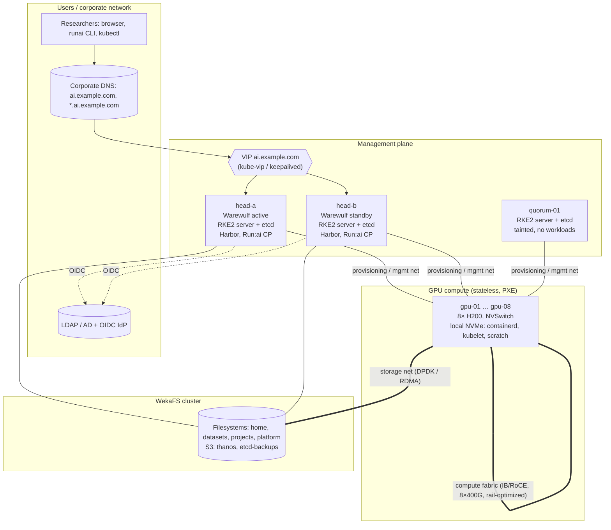
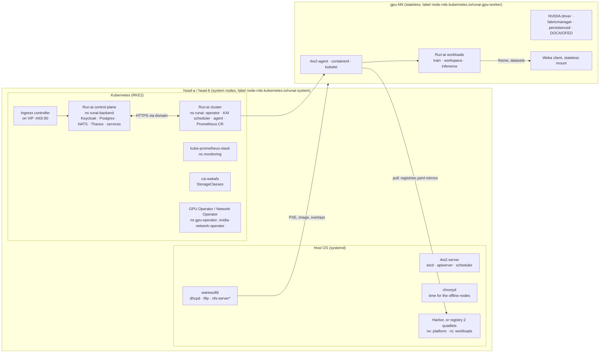
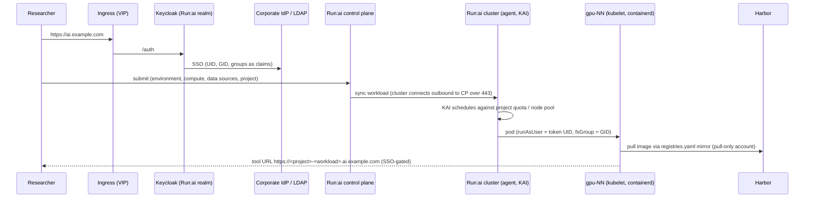
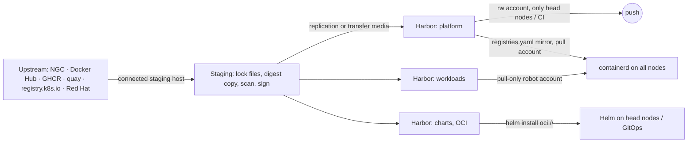
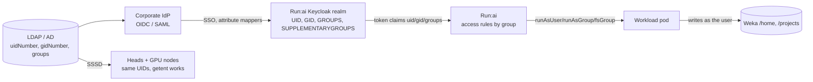
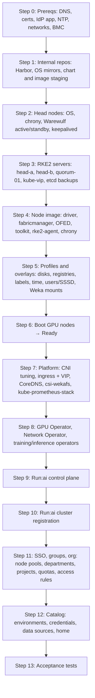

# Production Deployment Guide
## NVIDIA Run:ai on RKE2, with stateless GPU nodes provisioned by Warewulf

This guide turns the lessons from the lab build (3 arm64 VMs, simulated GPUs)
into a design for a real cluster. Names, addresses and sizes below are
**examples**; replace them with your site's values.

| Reference environment | |
|---|---|
| GPU compute | 8 × HGX H200 nodes, 8 × H200 141 GB SXM each = **64 GPUs** |
| Management | 2 × head nodes (Warewulf, RKE2 servers, registry, Run:ai control plane) |
| Quorum | 1 × small witness (VM or 1U server) for the third etcd member |
| Storage | WekaFS cluster (POSIX + S3 protocol) |
| Identity | Corporate LDAP/AD + OIDC/SAML IdP |

Software validated in the lab (re-check NVIDIA's support matrix before you pin):

| Component | Validated version | Delivered as |
|---|---|---|
| Warewulf | 4.7.1 | RPM on head nodes, `warewulfd` systemd service |
| RKE2 | v1.36.5+rke2r1 (containerd 2.x, K8s 1.36) | RPM, `rke2-server` / `rke2-agent` systemd services |
| NVIDIA Run:ai self-hosted | 3.0.20 | Helm charts `control-plane`, `runai-cluster` |
| kube-prometheus-stack | 92.16.1 | Helm chart |
| NVIDIA GPU Operator | v26.7.2 | Helm chart |
| Helm | v3.22.1 | binary on head nodes |
| Container OS image | Rocky Linux 9.x | Warewulf image |

---

## Contents

1. [Architecture](#1-architecture)
2. [Why everything comes from internal repositories](#2-why-everything-comes-from-internal-repositories)
3. [Networks, names and ports](#3-networks-names-and-ports)
4. [Head nodes: Warewulf, RKE2 servers, HA](#4-head-nodes-warewulf-rke2-servers-ha)
5. [Stateless GPU nodes](#5-stateless-gpu-nodes)
6. [Storage with WekaFS](#6-storage-with-wekafs)
7. [Kubernetes platform layer](#7-kubernetes-platform-layer)
8. [GPU and network operators](#8-gpu-and-network-operators)
9. [Run:ai control plane and cluster](#9-runai-control-plane-and-cluster)
10. [Identity, users and homes](#10-identity-users-and-homes)
11. [Organisation: partitions, departments, projects, quotas](#11-organisation-partitions-departments-projects-quotas)
12. [Workload catalog](#12-workload-catalog)
13. [Deployment order and acceptance gates](#13-deployment-order-and-acceptance-gates)
14. [Day-2 operations](#14-day-2-operations)
15. [Lessons learned → production practice](#15-lessons-learned--production-practice)
16. [Caveats and improvements](#16-caveats-and-improvements)

---

## 1. Architecture

### 1.1 Physical and network view



### 1.2 Service-level view

This mirrors the lab exactly; only the placement changes (two head nodes plus
a witness instead of one, Weka instead of an NFS export on the head node).



\* `nfs-server` on the head node is only needed if you keep Warewulf's
default `/home` NFS export. With Weka, `/home` should come from Weka (§6).

### 1.3 Request flow: a researcher starts a workload



### 1.4 Boot flow of a stateless GPU node

```mermaid
sequenceDiagram
  participant N as gpu-NN (BMC → PXE)
  participant W as warewulfd (VIP on head-a/b)
  participant S as systemd on node
  participant A as rke2-agent
  N->>W: DHCP + iPXE
  W-->>N: kernel, image, system overlay, runtime overlay
  N->>N: wwinit: load disk drivers → partition (same layout) → format once (node-marked)
  N->>N: copy image to tmpfs root, switch_root
  S->>S: mount NVMe: /var/lib/rancher, /var/lib/kubelet; mount Weka
  S->>S: chronyd (from heads), driver, fabricmanager, persistenced
  S->>A: start (RequiresMountsFor the NVMe paths)
  A->>A: join with agent-only token, node labels from Warewulf tags
  W-->>S: wwclient refreshes runtime overlay every minute (users, hosts)
```

---

## 2. Why everything comes from internal repositories

In the lab the GPU nodes had **no internet access at all**, and production
GPU nodes shouldn't either. Every artifact a node or pod touches must
therefore come from inside the site. That's a correctness requirement, not
just a convenience.

| Reason | What happens without it |
|---|---|
| **Air gap / security boundary** | GPU nodes would need egress (proxy rules, NAT) to Docker Hub, NGC, GHCR, quay, registry.k8s.io, Red Hat… a large, hard-to-audit attack surface. |
| **Reproducibility** | Tags move (`latest`, `9`, `16-alpine`). The lab mirrored Run:ai **by digest from NVIDIA's ArtifactLock**, so a rebuild in six months produces the same bits. |
| **Availability** | An upstream outage or rate limit (Docker Hub anonymous pulls) stops pod starts, node rejoins and Run:ai upgrades. |
| **Throughput** | H200 workload images (NGC PyTorch, vLLM, NIM) are 10–25 GB. Eight nodes pulling a new image from the internet at once is slow and expensive; pulling it from an on-site registry on Weka is not. |
| **Supply chain control** | Images can be scanned, signed and approved before users can select them. The workload catalog (§12) is the approved list. |
| **Licensing and compliance** | You know exactly which NVIDIA, Red Hat and third-party images are in use and where they came from. |

### 2.1 What needs an internal source

| Artifact | Production recommendation | Lab equivalent |
|---|---|---|
| Platform container images (RKE2, Run:ai, Prometheus, CSI, GPU operator, …) | **Harbor** project `platform` (replicated / proxy-cache from upstream, digest-pinned) | `registry:2` on :5000 |
| Helm charts | Harbor OCI (`oci://registry.example.com/charts`) | same, OCI in registry:2 |
| Workload images (user-selectable) | Harbor project `workloads`, **pull-only robot account** | read-only `registry:2` on :5001 |
| OS packages (Rocky, EPEL, CUDA/driver repo, DOCA/OFED, RKE2, Weka client) | Pulp / Satellite / reposync mirror on the head nodes or Weka | direct upstream (lab only) |
| Python/R/Conda packages for users | Nexus or Artifactory proxies (PyPI, CRAN, conda-forge, Hugging Face) | not covered |
| Models and datasets | Weka filesystem `datasets` + an approved import process | not covered |

### 2.2 Supply chain flow



### 2.3 Rules learned the hard way

1. **Mirror by digest from the vendor's lock file.** Run:ai publishes
   `runai-<ver>-standard-linux-<arch>.yaml` (ArtifactLock) listing every chart
   and image digest. NVIDIA's `runai-installer airgap pack/load` uses the same
   file. Copy with all architectures and preserved digests so digest
   references keep working.
2. **The lock is not complete.** Images the lab found missing at runtime:
   - `ubuntu:latest`: KAI's binder (`gpuSharingMode: NvFractions`) builds the
     GPU *reservation pods* of fractional workloads from a bare `ubuntu` image.
   - The Prometheus image the operator chooses for Run:ai's own `Prometheus` CR.
   - `prometheus-config-reloader`, passed to the operator as a command-line
     flag, so an `image:` scan of the rendered chart misses it.

   Render every chart with your real values, and also scan operator flags.
3. **Mirrors hide gaps.** containerd falls back to the upstream registry when
   a mirror lacks an image. A head node *with* internet silently pulls from
   Docker Hub, while the offline GPU nodes fail. After every install, check that
   **every image referenced by every pod exists in the internal registry**
   (the lab's verify step found two control-plane images being pulled from
   Docker Hub because of a path bug).
4. **Mind the mirror path convention.** `docker.io/postgres` is requested from
   a mirror as `library/postgres`. Store images where containerd will ask for them.
5. **Give the workload registry its own `registries.yaml` entry.** With a
   catch-all `"*"` mirror, pulls of `registry:5001/...` were redirected to the
   read-write registry, and the pull-only credentials Run:ai attaches to
   workloads failed there with `401` → `ImagePullBackOff` on every GPU node.
   Every registry host that workloads reference needs an explicit mirror entry
   pointing at itself.
6. **Separate push and pull credentials.** Nodes and workloads get
   **pull-only** accounts; only the staging pipeline can push. A plain
   `registry:2` has no per-user permissions, which is why the lab ran a second
   read-only instance; Harbor robot accounts solve this properly.
7. **Raise kubelet's pull rate limit.** The default (`registry-qps=5`,
   `burst=10`) throttles a cold start of ~30 Run:ai pods with `pull QPS
   exceeded`. With an on-site registry use `registry-qps=50`,
   `registry-burst=100`, or higher.

### 2.4 `registries.yaml` (every node, rendered by Warewulf; head nodes via config management)

```yaml
# /etc/rancher/rke2/registries.yaml
mirrors:
  docker.io:
    endpoint: ["https://registry.example.com"]
  "registry.example.com":                 # workload images: pull from itself
    endpoint: ["https://registry.example.com"]
  "*":
    endpoint: ["https://registry.example.com"]
configs:
  "registry.example.com":
    auth:
      username: robot$nodes-pull          # pull-only robot account
      password: <from secret store, rendered at overlay build time>
    tls:
      ca_file: /etc/rancher/rke2/site-ca.crt
```

With Harbor you'd normally use proxy-cache projects with path prefixes (for
example `registry.example.com/dockerhub/...`). In that case, use a `rewrite`
rule per upstream in `registries.yaml` instead of path-preserving mirrors.

---

## 3. Networks, names and ports

### 3.1 Networks (example ranges)

| Network | Example | Members | Purpose |
|---|---|---|---|
| BMC / OOB | 10.0.0.0/24 | all BMCs | power, console (Warewulf IPMI/Redfish) |
| Provisioning / management | 10.10.0.0/22 | heads, witness, GPU nodes | PXE, Warewulf, RKE2 node IPs, registry, NTP |
| Compute fabric | IB NDR or RoCE, rail-optimized | GPU nodes (8 × 400G each) | NCCL / GPUDirect RDMA between nodes |
| Storage | 100–400G Ethernet or IB | GPU nodes, heads, Weka | Weka (DPDK/RDMA), GDS |
| Corporate / user | site routed | VIP, head-node external NICs | UI, API, SSH to heads only |

Pick the RKE2 cluster CIDR and service CIDR (defaults `10.42.0.0/16`,
`10.43.0.0/16`) so they **don't overlap** any of these or your corporate ranges.

### 3.2 Names

| Name | Points to | Notes |
|---|---|---|
| `ai.example.com` | ingress VIP | Run:ai UI, REST API, Keycloak (`/auth`), CLI downloads, cluster↔control-plane traffic |
| `*.ai.example.com` | ingress VIP | per-workload tool URLs (RStudio, Jupyter, VS Code) with host-based routing |
| `registry.example.com` | registry VIP | Harbor |
| `k8s.example.com` | API VIP (kube-vip) | kubectl / Helm for administrators |
| `ww.example.com` | provisioning VIP | `warewulfd`, DHCP next-server |

The wildcard is required as soon as any tool needs its own hostname. RStudio
does, because Run:ai uses `routingMethod: host-base` for it. `/etc/hosts`
can't express wildcards, so this has to be real DNS.

In-cluster, pods must resolve `ai.example.com` to the ingress as well. If
corporate DNS isn't reachable from pods, add a CoreDNS `rewrite`
(HelmChartConfig for `rke2-coredns`) that points the name at the ingress Service.

### 3.3 Ports exposed outside the cluster

| Port | Where | Why |
|---|---|---|
| 443/tcp | ingress VIP | everything Run:ai: UI, API, Keycloak, tools, cluster sync |
| 80/tcp | ingress VIP | redirect to 443 only |
| 6443/tcp | API VIP | admin kubectl/Helm (restrict to admin subnets) |
| 443/tcp | registry VIP | Harbor (admins, staging) |

Internal only (provisioning network): 9345 (RKE2 supervisor), 6443, 2379–2380
(etcd), 10250 (kubelet), 8472/udp or 4789/udp (VXLAN for Canal/Flannel or
Cilium), 9873 (warewulfd), 67–69/udp (DHCP/TFTP), 123/udp (NTP),
2049 (NFS, if used), plus Weka's ports on the storage network.

---

## 4. Head nodes: Warewulf, RKE2 servers, HA

### 4.1 Sizing

Run:ai's documented minimums are **control plane: 10 cores / 12 GB / 110 GB**
and **cluster system nodes: 10 cores / 20 GB / 50 GB**, and these add up when
both share a cluster. Add RKE2/etcd, Harbor, Prometheus/Thanos, Keycloak and
Warewulf. Recommended per head node: **≥ 32 cores, ≥ 256 GB RAM, mirrored
NVMe for OS + etcd**, 2 × 25/100G to provisioning/corporate, and a storage-net
port for Weka.

> The lab had to cut every Run:ai request to about a fifth (a separate "lab"
> values file) to fit 3 × 4 cores. **Don't carry lab sizing into production.**
> Keep production values and lab overrides in separate files and leave the
> lab file out entirely.

### 4.2 etcd quorum needs three servers

Two head nodes alone **can't** form a fault-tolerant etcd cluster. With two
members, losing either one loses quorum. Options:

1. **Recommended:** a third RKE2 *server* on a small witness machine or VM
   (`quorum-01`), tainted `CriticalAddonsOnly=true:NoExecute` so it only runs
   etcd and the control plane.
2. Three dedicated control-plane servers, with the heads acting only as
   Warewulf/registry hosts.
3. An external datastore. Not recommended for this size.

```yaml
# /etc/rancher/rke2/config.yaml (head-a; head-b/quorum-01 add `server:`)
node-ip: 10.10.0.11
advertise-address: 10.10.0.11
tls-san: [k8s.example.com, 10.10.0.10, head-a, head-b, quorum-01]
cni: canal            # or cilium, see §7.1
etcd-snapshot-schedule-cron: "0 */6 * * *"
etcd-snapshot-retention: 28
etcd-s3: true         # Weka S3 bucket, see §6
etcd-s3-endpoint: s3.weka.example.com
etcd-s3-bucket: etcd-backups
# Run:ai node roles (node-role.kubernetes.io/runai-system) cannot be set via
# node-label: kubelet refuses node-role.kubernetes.io/* on servers and agents.
# Apply them with kubectl label after the node registers (see §5.5).
```

```yaml
# /etc/rancher/rke2/config.yaml.d/50-site.yaml  (drop-ins merge; "+" appends lists)
kubelet-arg+:
  - registry-qps=50
  - registry-burst=100
```

API high availability: run **kube-vip** as a static pod on the servers
(control-plane VIP `k8s.example.com`), so agents and admins use one address.

### 4.3 Warewulf on two heads (active/standby)

Warewulf has no active/active mode, and only **one** DHCP server may answer on
the provisioning network. Recommended pattern:

- `warewulf.conf`, `nodes.conf`, overlays and images in **git**, plus a shared
  location (Weka filesystem `platform`, or rsync from active to standby).
- **keepalived** VIP on the provisioning network for `warewulfd`, `dhcpd` and
  `tftp`. The standby keeps those services stopped and starts them on promotion.
- Images are rebuilt on the active head (`wwctl image build`) and synced.
- Overlay templates read secrets (join token, registry credentials, CA) from
  files on the head node at **overlay build time**. Those files must exist on
  both heads with the same contents.

> **Never start the stock `dnsmasq.service` on a Warewulf host.**
> `/etc/dnsmasq.d/` contains Warewulf's generated DHCP/TFTP configuration for
> its optional dnsmasq backend. Starting the stock service (for example to
> provide DNS) brings up a **second DHCP and TFTP server** on the provisioning
> network next to `dhcpd`. It happened in the lab. If you need DNS on a head
> node, run a dedicated unit that loads only its own config file, for example
> `dnsmasq --conf-file=/etc/site/dns.conf`.

### 4.4 Head node OS

- SELinux **enforcing** on the heads. Mind container volume labels: a second
  container that relabels (`:Z`) a path another container already labelled
  locks the first one out. Use shared labels (`:z`), or no relabelling with
  read-only mounts.
- chronyd synced to corporate NTP, serving the provisioning network
  (`allow 10.10.0.0/22`, `local stratum 10`) so nodes keep a common clock even
  if upstream NTP fails. Use **`makestep 1.0 -1`**. With EL's default
  (`makestep 1.0 3`), a host that resumes far off (VM pause, bad RTC) only
  slews, for days. Keycloak tokens issued there are then rejected by
  `cluster-api` on correctly-timed nodes, which breaks the UI terminal and
  cluster↔control-plane calls.
- `/etc/exports.d/*.exports` for any extra NFS exports, because Warewulf
  rewrites `/etc/exports`.

---

## 5. Stateless GPU nodes

### 5.1 Profiles and overlays (layered, like the lab)

| Profile | Contents |
|---|---|
| `default` | wwinit, wwclient, hosts, hostname, network (NetworkManager), ssh keys, ignition (mount units), fstab |
| `rke2` | image with `rke2-agent` (version-pinned, disabled in image), `Root=tmpfs`, gateway, rke2 overlay |
| `gpu-h200` | NVIDIA driver/fabricmanager/DOCA in the image, `chrony`, `sfdisk`, `syncuser` (or SSSD), site overlay, disks, tags (partition, labels) |

Nodes: `wwctl node set gpu-NN --profile default,rke2,gpu-h200`.

**`Root=tmpfs` is required.** With the default initramfs root, runc can't
`pivot_root`, so every container fails.

### 5.2 What the site overlay renders per node

| File | Purpose |
|---|---|
| `/etc/rancher/rke2/config.yaml` | `server: https://k8s.example.com:9345`, **agent-only bootstrap token** (`rke2 token create`), `node-name`, `node-ip` |
| `/etc/rancher/rke2/config.yaml.d/50-site.yaml` | `node-label+:` from tags (partition, rail, GPU type), kubelet args (pull QPS, reserved CPUs for Weka, see §6) |
| `/etc/rancher/rke2/registries.yaml` | mirrors + pull-only credentials (§2.4) |
| `/etc/rancher/node/password` | stable per-node password derived from node ID + seed, so stateless reboots are not rejected |
| `/etc/sysctl.d/90-site.conf` | `fs.inotify.max_user_instances=8192`, `max_user_watches=524288` |
| `/etc/systemd/system/rke2-agent.service.d/…` | `RequiresMountsFor=/var/lib/rancher /var/lib/kubelet` |
| `/etc/NetworkManager/conf.d/…` | ignore `cali*`, `flannel*` (or `cilium*`, `lxc*`) |
| chrony, `/etc/chrony.d/` | time from the head VIP; **ship the `chrony.d` directory**, because Warewulf's chrony template includes it and chronyd exits if it's missing |

Why the bootstrap token and not the server token: overlays are served over
the provisioning network. An agent-only token can join agents but never a server.

### 5.3 Local NVMe for containerd and kubelet

The tmpfs root lives in RAM. In the lab, with 16 GB nodes, the OS plus RKE2
images already used half of the tmpfs root. H200 workload images are tens of
GB, so they must not land in RAM. Each H200 node has local NVMe:

| Partition (GPT label) | Mount | Use |
|---|---|---|
| `rke2` | `/var/lib/rancher` | containerd images and snapshots, agent data |
| `kubelet` | `/var/lib/kubelet` | emptyDir, pod volumes, logs |
| `scratch` (optional) | `/scratch` | fast local scratch (Run:ai host-path data source) |

Warewulf config:

```bash
wwctl profile set gpu-h200 --diskname /dev/nvme0n1 --diskwipe \
  --partname rke2 --partnumber 1 --partsize 1048576 --partcreate \
  --fsname rke2 --fsformat ext4 --fspath /var/lib/rancher
wwctl profile set gpu-h200 --diskname /dev/nvme0n1 \
  --partname kubelet --partnumber 2 --partsize 1048576 --partcreate \
  --fsname kubelet --fsformat ext4 --fspath /var/lib/kubelet
```

Lessons from Warewulf 4.7.1 (fix them in your site overlay; re-check on newer releases):

1. **wwinit runs before udev.** Modular disk drivers (`nvme`, `virtio_blk`,
   `ahci`/`sd_mod`) aren't loaded yet, so the stock `sfdisk` step finds no disk.
   Add a wwinit script that `modprobe`s them and waits for the device.
2. **The stock `mkfs` overlay never formats a blank disk.** It tests
   `wipefs -n`, which exits 0 even on blank devices. `--fswipe` works around it
   but then reformats on **every** boot. Use a format-once script: format only
   if `blkid -p` finds no filesystem signature.
3. **Identify partitions by kernel `PARTNAME`** (`/sys/class/block/*/uevent`).
   `/dev/disk/by-partlabel` doesn't exist yet in wwinit.
4. **`--diskwipe` rewrites the GPT at every boot** with the same layout. Data
   inside the partitions survives (verified), which is what lets the image cache
   persist across reboots.
5. **Mark each filesystem with its owning node ID.** A disk moved between nodes
   (or a cloned VM) carries the previous node's kubelet certificates and
   impersonates it, and the server rejects it. Reformat on mismatch, and adopt
   unmarked disks. Log wwinit output to a file in the root image so it survives
   `switch_root` and you can debug boots without a console.
6. Don't start `rke2-agent` when the disk mount failed (`RequiresMountsFor`);
   otherwise images silently fill RAM instead.

### 5.4 GPU stack in the image (HGX H200)

Bake the driver into the Warewulf image rather than letting a driver
container compile at every boot of a stateless node:

- NVIDIA datacenter driver, matching the GPU Operator's support matrix. For
  Run:ai **GPU fractions**, NVIDIA requires GPU Operator ≥ 26.7.1 **and driver
  r615+**.
- **`nvidia-fabricmanager`**, required on HGX (NVSwitch) systems, otherwise
  CUDA can't use the GPUs. Enable it in the image or overlay.
- `nvidia-persistenced`.
- DOCA-OFED / MLNX_OFED for ConnectX-7 and BlueField-3, plus `nvidia-peermem`
  for GPUDirect RDMA.
- `nvidia-container-toolkit`. RKE2 detects `nvidia-container-runtime` and
  creates the containerd `nvidia` runtime handler for the `nvidia`
  RuntimeClass it ships.
- Kernel pinned: driver, OFED and Weka client all depend on the exact kernel.
  Rebuild the image whenever any of them changes.

### 5.5 Node identity and labels

- Partition membership, GPU type and rail come from **Warewulf tags**,
  rendered into `node-label+`. RKE2 records `--node-label` and re-applies it on
  restart, so Warewulf stays the source of truth.
- Kubelet **can't** set `node-role.kubernetes.io/*` labels. Apply Run:ai node
  roles (`runai-gpu-worker`, `runai-system`) from the server side with
  `kubectl label` (the node object survives reboots), or with a small
  controller or GitOps job.

---

## 6. Storage with WekaFS

The lab's weakest point was an NFS export **on the head node** (a single
point of failure, and slow). Weka replaces it for everything.

| Consumer | Weka feature | Notes |
|---|---|---|
| `/home` (users) | WekaFS POSIX mount on every GPU node and head | the same paths and UIDs everywhere; quotas via Weka directory quotas |
| Shared datasets, models | filesystem `datasets` | read-mostly; Run:ai host-path or PVC data sources |
| Project working dirs | filesystem `projects` (`/projects/<group>`) | group-owned (GID of the Unix group = Run:ai project) |
| Dynamic PVCs (Run:ai PVC data sources, control-plane DBs) | **csi-wekafs** Helm chart, StorageClasses | default StorageClass for Run:ai |
| Thanos (Run:ai metrics), etcd snapshots, Harbor blobs | **Weka S3** | object storage instead of block |
| GPUDirect Storage | Weka GDS | high-throughput dataset reads into GPU memory |

### 6.1 Clients on stateless nodes

- Use Weka **stateless clients**: `mount -t wekafs <backend>/<fs> /mnt/<fs>`
  downloads the client from the backend at mount time, so the Warewulf image
  stays small. Mount from a systemd unit or fstab entry in the site overlay,
  ordered **before** `rke2-agent`.
- DPDK mode dedicates **frontend cores** that busy-poll, and needs hugepages.
  Keep Kubernetes off those cores: `kubelet-arg+: [reserved-cpus=<weka cores>]`
  (or the CPU manager static policy with matching reservations), plus
  `system-reserved` memory for the hugepages. Otherwise pods compete with the
  storage client.
- Confirm client version, NIC selection (`net=`), core count and GDS settings
  with Weka for HGX H200.

### 6.2 Kubernetes storage

```bash
helm upgrade --install csi-wekafs oci://registry.example.com/charts/csi-wekafsplugin \
  -n csi-wekafs --create-namespace -f values/csi-wekafs.yaml
```

```yaml
# StorageClass for Run:ai control-plane state and user PVCs
apiVersion: storage.k8s.io/v1
kind: StorageClass
metadata:
  name: weka-platform
  annotations: {storageclass.kubernetes.io/is-default-class: "true"}
provisioner: csi.weka.io
reclaimPolicy: Retain          # Postgres/Keycloak data must survive uninstalls
allowVolumeExpansion: true
volumeBindingMode: Immediate
parameters:
  volumeType: dir/v1
  filesystemName: platform
  capacityEnforcement: HARD
  csi.storage.k8s.io/provisioner-secret-name: csi-wekafs-api-secret
  csi.storage.k8s.io/provisioner-secret-namespace: csi-wekafs
  # (node/controller publish secrets likewise)
```

Use **`Retain`** for the platform class. The lab used NFS with
`onDelete: archive` so that an uninstall couldn't destroy Run:ai's database.

### 6.3 Homes inside workloads

Two production-grade mechanisms, both proven in the lab with NFS:

1. A Run:ai **host-path data source** `home` (`/home` → `/home`) that users
   attach to a workload.
2. Cluster-wide injection with a **`MutatingAdmissionPolicy`** (in-process,
   Kubernetes ≥ 1.34, no webhook or TLS): pods in a namespace labelled
   `runai/queue` get `/home` mounted, unless they already mount `/home` or
   carry an opt-out annotation. **Match only pods that run as a site user**
   (`runAsUser` in the site's UID range, i.e. `fromIdpToken` environments).
   Images whose own user lives in `/home` (Jupyter's `jovyan`, code-server's
   `coder`) fail to start when site homes are mounted over it. Keep
   `failurePolicy: Fail` only if you accept that a broken policy blocks
   workload pods; `Ignore` is safer operationally.

Either way the container must run **as the user's UID/GID** (§10). Root in a
container can't write a `0700` home over a root-squashed export, and on an
SELinux-enforcing head node a container can't write host `/home` at all. That
is one more reason **user workloads must never run on head nodes** (§11.3).

---

## 7. Kubernetes platform layer

### 7.1 CNI

The lab used RKE2's default **Canal**. For 8 × H200:

- Pod-to-pod traffic (API, control plane, small services) stays on the
  primary CNI. **Cilium** (eBPF, kube-proxy replacement) is the usual
  production choice; Canal is fine at this size.
- Inter-node GPU traffic (NCCL) must **not** go through the overlay. Use
  NVIDIA Network Operator + **Multus** secondary networks (SR-IOV or host-device
  RDMA) on the compute fabric (§8.2).
- NetworkManager must ignore CNI interfaces (overlay file in §5.2).

### 7.2 Ingress and the VIP

The lab exposed Run:ai through RKE2's Traefik using `hostPort` 80/443 on
every node. That works, but in production:

- Run the ingress controller only on system nodes (head-a/b), with a **VIP**
  (kube-vip in Service mode, or MetalLB L2/BGP) that `ai.example.com` and
  `*.ai.example.com` resolve to.
- NVIDIA recommends **HAProxy** or nginx ingress; the Run:ai control plane
  renders a single catch-all Ingress to its internal gateway, so Traefik works
  as well. Pick one and set `global.ingress.ingressClass` (control plane) and
  `clusterConfig.global.ingress.ingressClass` (cluster) to it.
- Add an http→https redirect (Traefik `Middleware` or the controller's equivalent).

RKE2 customisations go in **HelmChartConfig** manifests in
`/var/lib/rancher/rke2/server/manifests/`, for example:

```yaml
apiVersion: helm.cattle.io/v1
kind: HelmChartConfig
metadata: {name: rke2-coredns, namespace: kube-system}
spec:
  valuesContent: |-
    servers:
      - zones: [{zone: ., use_tcp: true}]
        port: 53
        plugins:
          - {name: errors}
          - {name: health, configBlock: lameduck 10s}
          - {name: ready}
          - name: rewrite            # only if pods cannot resolve the domain via corporate DNS
            parameters: stop
            configBlock: |-
              name exact ai.example.com <ingress-service>.<ns>.svc.cluster.local
              answer auto
          - {name: kubernetes, parameters: cluster.local in-addr.arpa ip6.arpa,
             configBlock: "pods insecure\nfallthrough in-addr.arpa ip6.arpa\nttl 30"}
          - {name: prometheus, parameters: "0.0.0.0:9153"}
          - {name: forward, parameters: ". /etc/resolv.conf"}
          - {name: cache, parameters: 30}
          - {name: loop}
          - {name: reload}
          - {name: loadbalance}
```

`servers` replaces the chart's whole list, so always restate the defaults.

### 7.3 TLS and certificates

- One certificate for `ai.example.com` + `*.ai.example.com` from the
  **corporate CA** (or cert-manager with an internal ACME/Vault issuer).
- Secrets Run:ai expects:

| Secret | Namespace | Contents |
|---|---|---|
| `runai-backend-tls` | runai-backend | domain cert (full chain) + key |
| `runai-ca-cert` (`runai-ca.pem`) | runai-backend, runai | corporate CA, only if it's private |
| `runai-cluster-domain-tls-secret` | runai | domain cert |
| `runai-cluster-domain-star-tls-secret` | runai | wildcard cert (host-based tool URLs) |

- Label the `runai` copy of `runai-ca-cert` with
  `run.ai/cluster-wide=true, run.ai/name=runai-ca-cert`. Run:ai then replicates
  it into **every project namespace**, so workloads can trust internal
  services. Set `global.customCA.enabled=true` in both charts.

### 7.4 Monitoring

- **kube-prometheus-stack** is a hard Run:ai prerequisite: it provides the
  Prometheus Operator CRDs. Run:ai creates its own `Prometheus` CR in
  namespace `runai`, and the control plane stores metrics in Thanos. Point
  Thanos at **Weka S3** for long retention.
- DCGM exporter from the GPU Operator must run in namespace `gpu-operator`
  (or set `clusterConfig.global.nvidiaDcgmExporter.namespace`).
- Alert on at least: etcd health and backup age; node NotReady; GPU XID
  errors; fabricmanager down; Run:ai cluster state ≠ `Connected`; any pod in
  `ImagePullBackOff`; Weka mount health; time offset > 1 s; certificate expiry.

---

## 8. GPU and network operators

### 8.1 NVIDIA GPU Operator (driver preinstalled in the image)

```yaml
# values/gpu-operator.yaml
driver:
  enabled: false                  # driver baked into the Warewulf image (§5.4)
toolkit:
  env:
    - {name: CONTAINERD_SOCKET, value: /run/k3s/containerd/containerd.sock}   # RKE2's containerd
cdi:
  nriPluginEnabled: false         # Run:ai GPU fractions do not work with NRI
dcgmExporter:
  serviceMonitor: {enabled: true}
migManager:
  enabled: true                   # optional: MIG profiles on H200 for interactive pools
```

```bash
helm upgrade --install gpu-operator oci://registry.example.com/charts/gpu-operator \
  --version v26.7.2 -n gpu-operator --create-namespace -f values/gpu-operator.yaml
```

Caveats:

- RKE2 ships RuntimeClasses `nvidia` and `nvidia-experimental` (addon
  `rke2-runtimeclasses`). Charts that try to create their own `nvidia`
  RuntimeClass fail with *invalid ownership metadata*; disable theirs.
- Run:ai gives fractional-GPU pods `runtimeClassName: nvidia`. On real nodes
  the toolkit provides the handler. On simulated nodes (§8.3) you need a stand-in.

### 8.2 NVIDIA Network Operator (multi-node training)

For NCCL across nodes, deploy the Network Operator with DOCA/OFED (or rely on
the image's OFED), an RDMA shared device plugin or SR-IOV device plugin, and
Multus with one secondary network per rail. Run:ai distributed workloads
(PyTorch, MPI) then request the RDMA resources. Run:ai also needs the Kubeflow
Training Operator (and MPI Operator, if used) for distributed training, and
LeaderWorkerSet for multi-node inference. Mirror their images too.

### 8.3 Simulated GPUs for staging and CI

Run:ai's **fake-gpu-operator** (chart `oci://ghcr.io/run-ai/fake-gpu-operator`)
advertises `nvidia.com/gpu` and DCGM-style metrics on nodes labelled
`run.ai/simulated-gpu-node-pool=<pool>`. Scheduling, quotas, fractions and
dashboards then behave as on real hardware. The lab used it to build and test
the entire platform without a GPU. Recommended uses: a **staging cluster**
that mirrors production config, CI for upgrades, and training admins.

Caveats seen:

- Fractions need the `nvidia` runtime handler. On fake nodes, a one-line
  `/usr/bin/nvidia-container-runtime` that `exec`s RKE2's runc makes RKE2
  register it. Never deploy that shim on real GPU nodes.
- Changing a node's simulated pool needs its per-node `topology-<node>`
  ConfigMap deleted and the status-updater restarted.

---

## 9. Run:ai control plane and cluster

### 9.1 Control plane (`control-plane` chart, release `runai-backend`)

```yaml
# values/control-plane.yaml (production; no lab sizing file)
global:
  domain: ai.example.com
  ingress:
    ingressClass: haproxy          # or nginx / traefik
    tlsSecretName: runai-backend-tls
  customCA:
    enabled: true                  # only with a private CA
  affinity:                        # keep the control plane on system nodes
    nodeAffinity:
      requiredDuringSchedulingIgnoredDuringExecution:
        nodeSelectorTerms:
          - matchExpressions:
              - {key: node-role.kubernetes.io/runai-system, operator: Exists}
  imagePullSecrets: [{name: runai-reg-creds}]   # Harbor pull account
tenantsManager:
  config:
    adminUsername: runai-admin@example.com
    existingSecret: runai-admin    # key ADMIN_PASSWORD; never on the command line
postgresql:
  primary:
    persistence: {storageClass: weka-platform, size: 50Gi}
thanos:
  receive:
    persistence: {storageClass: weka-platform, size: 200Gi}
  # objstore: Weka S3 bucket for long-term metrics (see chart values)
```

```bash
helm upgrade --install runai-backend oci://registry.example.com/charts/control-plane \
  --version 3.0.20 -n runai-backend -f values/control-plane.yaml --wait --timeout 30m
```

Notes:

- PostgreSQL and Keycloak install with generated credentials. Rotate them as
  described in Run:ai's *advanced control plane configuration*. For a larger
  site, use an **external HA Postgres**.
- The control plane requests about 10 cores at default sizing. Give it that;
  don't shrink requests in production.
- Expect "permission denied to create role" errors in the Postgres log during
  the first install. Services retry and migrations complete.

### 9.2 Cluster registration (automatable; the docs only show the UI wizard)

```text
POST /api/v2/token                                     (form: grant_type=password, client_id=cli)
POST /api/v1/clusters                {"name": "prod"}  -> uuid
GET  /api/v1/clusters/<uuid>/cluster-install-info?version=3.0.20   -> bootstrapToken (valid 2 h)
```

```yaml
# values/runai-cluster.yaml
controlPlane:
  url: ai.example.com              # same Kubernetes cluster: cluster.url = control-plane domain
cluster:
  url: ai.example.com
global:
  customCA: {enabled: true}
  affinity:                        # Run:ai system components on system nodes
    nodeAffinity:
      requiredDuringSchedulingIgnoredDuringExecution:
        nodeSelectorTerms:
          - matchExpressions:
              - {key: node-role.kubernetes.io/runai-system, operator: Exists}
clusterConfig:
  global:
    ingress: {ingressClass: haproxy}
    subdomainSupport: true         # host-based tool URLs (RStudio etc.)
    nodeAffinity:
      restrictScheduling: true     # user workloads only on runai-gpu-worker / runai-cpu-worker nodes
```

Pass the bootstrap token in a **0600 values file**, not with `--set`. Fetch a
fresh token on every run so re-runs are idempotent. Wait for the cluster
state `Connected`, with all operands ready.

Cluster dependencies reported by Run:ai, required versus optional:

| Required | Optional (feature) |
|---|---|
| GPU stack (operator, DCGM, fractions) | Knative + Kourier (single-node inference) |
| Prometheus | LeaderWorkerSet (multi-node inference) |
| | Kubeflow Training Operator, MPI Operator (distributed training) |
| | NIM Operator, Grove, Dynamo |

### 9.3 API usage notes (Run:ai 3.0)

- Asset-based submission, which is what the UI does:
  `POST /api/v2/training` / `/api/v2/workspace` with
  `{meta:{name,projectId,clusterId}, assets:{environment, compute, datasources:[{id,kind}]}, specificRunParams:{command,args}}`.
- **Use the same API family for create and delete.** A workload created via v2
  and deleted via the v1 endpoint left a "ghost" in the control-plane DB:
  listed as `Running`, but every action failed with *Failed to get by id*. It
  had to be removed from Postgres by hand. Delete with the type-specific
  endpoint matching the create path, and verify the workload is gone.
- Environment updates (`PUT /api/v1/asset/environment/<id>`) accept only
  mutable meta fields (`name`, `description`). Scope and supported types are
  fixed at creation.
- Generic-secret credentials and data sources built on them can't be
  tenant-scoped; use cluster scope or lower.
- Department/project updates: `PUT /api/v1/org-unit/{departments|projects}/<id>`
  with `resources` **and** `defaultNodePools` together.
- Pagination limits apply (for example, access rules max 500 per page).
- **UI terminal:** a WebSocket to
  `wss://<cluster URL>/cluster-api/api/v1/<project>/workloads/external/external/<externalWorkloadName>/exec?...&command=["/bin/bash"]`,
  with the bearer token in the subprotocol (`auth.bearer.<token>`). When
  control plane and cluster share a Kubernetes cluster, the control plane's
  gateway routes `/cluster-api` to `cluster-api.runai:4190`, so no extra
  Ingress is needed. A remote cluster must expose `/cluster-api` on its own
  cluster URL, and the ingress must allow WebSocket upgrades. If it fails,
  `runai/cluster-api` logs say why (expired token, unknown workload).

---

## 10. Identity, users and homes

### 10.1 Production identity chain



- Run:ai's Keycloak realm already maps user attributes `UID`, `GID`,
  `GROUPS` and `SUPPLEMENTARYGROUPS` into the token claims `uid`, `gid`,
  `groups` and `supplementarygroups`. Configure SSO so the IdP/LDAP fills them.
- Environments with `uidGidSource: fromIdpToken` run the container as that
  user (`runAsUser`, `runAsGroup`, `fsGroup`, `supplementalGroups`), and
  Run:ai also exports `LDAP_UID` / `LDAP_GID`. Run:ai **doesn't set `$HOME`
  or a user name** inside the container: users work in `/home/<user>`, or your
  images derive it.
- Tools that need root at start-up (rocker/rstudio's s6 init, for example)
  keep `uidGidSource: fromTheImage`; their access is protected by Run:ai's SSO
  proxy instead.
- Nodes use **SSSD** against the same directory, so UIDs, GIDs and group
  memberships match the files on Weka. The lab used Warewulf's `syncuser`
  runtime overlay, which wwclient refreshes every minute without reboots. That's
  fine for small static sets; SSSD is the production answer.

### 10.2 Local users: break-glass only

The lab created 50 local users through the Run:ai API plus the Keycloak admin
API. Things to know if you ever need local accounts:

- Run:ai generates a temporary password. Setting a chosen one requires the
  Keycloak admin API (`reset-password`, `temporary:false`).
- The realm enforces a **10-password history**: re-setting the same password
  fails. Verify by logging in rather than resetting blindly.
- Keep one local `runai-admin` and an SSO admin group; everything else comes
  from SSO.

### 10.3 Access model (groups, not people)

| Subject | Role | Scope |
|---|---|---|
| IdP group `<research-group>` | AI practitioner | project `<research-group>` |
| PI / group lead (user or group) | Project administrator | the group's project |
| `hpc-admins` group | System administrator | tenant |
| `<dept>-leads` group | Department administrator | department |

A group-based access rule (`subjectType: group`) works as soon as the token
carries that name in `groups`. The lab verified this end to end, including
denial when a user submits into another group's project (403).

---

## 11. Organisation: partitions, departments, projects, quotas

### 11.1 Slurm → Run:ai mapping

| Slurm | Run:ai | Notes |
|---|---|---|
| `PartitionName=… Nodes=…` | **node pool** (label `runai/node-pool=<name>`) | node label from Warewulf tags |
| `Default=YES` | `defaultNodePools` on department (inherited by projects) | keeps work off system nodes |
| parent account | **department** | quota per node pool |
| leaf account / Unix group | **project** (namespace `runai-<project>`) | GID = group; access via IdP group |
| `GrpTRES=gres/gpu:N` | `gpu.deserved` per node pool | guaranteed, non-preemptible share |
| `MaxTRES` / ceiling | `gpu.limit` per node pool | hard cap including over-quota |
| Fairshare | `overQuotaWeight` (tenant setting `project.quota.manual_over_quota` must be **enabled**, it's off by default) | share of idle GPUs |
| preemption | over-quota jobs are preemptible; Run:ai reclaims them for in-quota work | |
| interactive jobs (`salloc`) | **workspaces are non-preemptible**: they run **only within guaranteed quota** (`NonPreemptibleOverQuota`) | every project whose users open workspaces/notebooks needs a non-zero guarantee in a pool they default to |
| `sshare` / `sreport` | Run:ai Departments/Projects views, `status.nodePoolQuotaStatuses`, workloads API | |

### 11.2 Example for 64 H200s

| Node pool | Nodes | GPUs | Intended use |
|---|---|---|---|
| `h200-train` | gpu-01 … gpu-06 | 48 | batch / distributed training (whole GPUs, multi-node) |
| `h200-interactive` | gpu-07, gpu-08 | 16 | workspaces, notebooks, RStudio, fractions/MIG, debugging |

| Department | `h200-train` quota | `h200-interactive` quota | Projects (Unix groups, GID) |
|---|---|---|---|
| physics | 12 | 4 | phys-astro (5100), phys-hep (5200) |
| chemistry | 12 | 4 | chem-comp (5300), chem-materials (5400) |
| biology | 12 | 4 | bio-genomics (5500), bio-imaging (5600) |
| cs | 12 | 4 | cs-ml (5700), cs-systems (5800) |

Rules:

- Department quotas sum to pool capacity, and project quotas sum to their
  department's. Validate this before applying.
- Set limits above quota where bursting is welcome, and at quota where it
  isn't.
- Fractional quotas are allowed (0.5 GPU).
- Keep the definition **declarative** (one YAML file in git, the equivalent
  of `slurm.conf` + `sacctmgr`) and apply it idempotently through the API.

### 11.3 Keep user workloads off system nodes

The lab found this the hard way. CPU-only workloads landed in the `default`
node pool, which was the head node, where `/home` was local and
SELinux-enforcing and writes failed. In production:

1. `defaultNodePools: [h200-train, h200-interactive]` on every department,
   **including Run:ai's built-in `default` department**, which parents projects
   created ad hoc in the UI.
2. `clusterConfig.global.nodeAffinity.restrictScheduling: true` with node
   roles: `runai-system` on heads, `runai-gpu-worker` on GPU nodes.
3. The witness node is tainted and runs no workloads.

### 11.4 Quota monitoring

What the lab verified, with real users submitting as themselves:

- **Within quota**: runs, non-preemptible share.
- **Over quota with idle capacity**: runs as preemptible.
- **Above the limit**: stays Pending.
- **Reclaim**: when a group submits within its guarantee and the pool is full,
  Run:ai preempts another group's over-quota work.

Monitor it through:

- Run:ai UI: Overview, Departments, Projects (allocated vs quota per node
  pool), Workloads (per user).
- API: `GET /api/v1/org-unit/projects` → `status.nodePoolQuotaStatuses[]`
  (`allocated`, `requested` per pool); `GET /api/v1/workloads` (`submittedBy`,
  `allocatedResources.gpu`); pods → `currentNodePool`.
- Prometheus/Thanos metrics and Grafana dashboards; alert on projects pending
  above quota for a long time and on idle allocated GPUs.

---

## 12. Workload catalog

Run:ai **Environments** are what users pick. Treat them as a curated,
version-pinned catalog:

```yaml
# catalog/environments.yaml (declarative; applied via the API)
environments:
  - name: ubuntu
    image: registry.example.com/workloads/ubuntu:24.04
    uidGidSource: fromIdpToken
    command: sleep
    args: infinity
  - name: pytorch
    image: registry.example.com/workloads/nvcr-pytorch:26.09-py3
    uidGidSource: fromIdpToken
  - name: rstudio
    image: registry.example.com/workloads/rstudio:4.6.2
    env: {DISABLE_AUTH: "true"}    # Run:ai SSO is in front of the tool
    connections:
      - name: RStudio
        internalToolInfo: {toolType: rstudio, connectionType: ExternalUrl, containerPort: 8787, externalUrlInfo: {}}
    routingMethod: host-base       # needs *.ai.example.com + subdomainSupport
    training: false
```

- **Replace Run:ai's built-in environments.** They reference unpinned
  upstream images (`rocker/rstudio`, `jupyter/scipy-notebook`,
  `vllm/vllm-openai`, …) and stay in `ImagePullBackOff` on an offline cluster;
  some upstream locations no longer exist at all (`docker.io/jupyter/*`).
  Re-point the useful ones at internal copies **keeping their spec** (tool
  connections, commands, variables), and delete the rest. Then enforce it:
  after each catalog change or Run:ai upgrade, remove every environment whose
  image doesn't resolve in the internal registry.
- Keep a simple "mirror this image" procedure for admins (copy all
  architectures with digests into the workloads project). Publishing an image
  as an Environment is a separate, reviewed step.
- Give workloads **pull-only** registry access as a Run:ai Docker-registry
  credential (attached to workloads automatically).
- For users who need to *query* the registry (list tags), provide a Run:ai
  generic-secret credential (URL, user, password, CA) mounted through a
  **Secrets data source**.
- Pin tags, mirror all architectures, scan before publishing.

---

## 13. Deployment order and acceptance gates



| Gate | Pass criteria |
|---|---|
| Repos | every chart/image in the vendor locks present **by digest**; GPU nodes can pull with no internet route |
| Time | all nodes within 100 ms of the heads (`chronyc tracking`) before any Run:ai install |
| Nodes | `Ready`, NVMe mounted, images on NVMe (not tmpfs), labels correct, `nvidia-smi` shows 8 × H200, fabricmanager active, NVLink OK |
| Storage | Weka mounted on all nodes; default StorageClass provisions and binds; PVC write test from a GPU node |
| Ingress | `https://ai.example.com` valid cert from a client; `http` redirects; wildcard resolves; in-cluster resolution works |
| Run:ai | cluster `Connected`, all operands ready, required dependencies `available` |
| GPU | 1-GPU and 0.5-GPU workloads Running; multi-node NCCL all-reduce over RDMA at expected bandwidth |
| Identity | one user per group: sees only their project, refused elsewhere, runs as their UID/GID, writes own home, can't read others' |
| Quotas | in-quota, over-quota, limit and reclaim scenarios behave as designed |
| Offline | **every image of every pod** resolves in the internal registry |

---

## 14. Day-2 operations

### 14.1 Upgrades

| Component | Procedure |
|---|---|
| RKE2 | servers one at a time (snapshot first); then rebuild the node image with the matching `rke2-agent`, mirror the new RKE2 image lists, rolling-reboot GPU nodes |
| Run:ai | get the new ArtifactLock → mirror by digest → `helm upgrade` control plane → cluster (new bootstrap token) → check dependencies and the support matrix (GPU operator, K8s version) |
| GPU driver / OFED / kernel | new image version in Warewulf → canary one node → drain (Run:ai: stop or wait for workloads) → rolling reboot |
| GPU Operator | chart upgrade after confirming driver compatibility; fractions need ≥ 26.7.1 + r615 driver |
| Catalog | new tag in the catalog file → mirror → update the environment (users get it on next submit) |

Stateless nodes make rollbacks trivial: point the profile back at the
previous image and reboot.

### 14.2 Backups

| What | How |
|---|---|
| etcd | RKE2 scheduled snapshots → Weka S3 (`etcd-s3`) |
| Run:ai Postgres | scheduled `pg_dump` (or external HA DB backups) |
| Keycloak realm | realm export (users come from SSO, but clients, mappers and roles matter) |
| Warewulf | `nodes.conf`, `warewulf.conf`, overlays, image definitions in git |
| Org definition, catalog, values | git (GitOps: Argo CD / Fleet) |
| Secrets | secret store (Vault / External Secrets), never in git |

### 14.3 Node lifecycle

- **Replacing a node or moving a disk:** the node-ID marker on the local
  filesystems forces a clean reformat. Without it, a moved disk impersonates
  its previous node and is rejected.
- **Adding a node:** `wwctl node add …` with tags (partition, rail), boot,
  apply server-side role labels. Run:ai picks it up into its node pool from the label.
- **Draining for maintenance:** cordon, let Run:ai finish or preempt work,
  reboot, uncordon.

---

## 15. Lessons learned → production practice

| # | What happened in the lab | Production practice |
|---|---|---|
| 1 | Head node clock 70 min off; offline nodes had no time source | NTP from heads to all nodes; time-offset alert; gate installs on sync |
| 2 | Mirrors silently fell back to Docker Hub on the head node | offline verification of every pod image after every change |
| 3 | `docker.io/x` stored without `library/` | follow containerd's mirror path conventions; test pulls from an offline node |
| 4 | KAI reservation pods needed `ubuntu:latest` (not in lock) | render charts, read operator flags, run end-to-end tests offline, extend the lock |
| 5 | Prometheus config-reloader image passed as an operator flag | image discovery must scan args, not only `image:` |
| 6 | `pull QPS exceeded` on cold start | kubelet `registry-qps` / `registry-burst` raised |
| 7 | Catch-all mirror redirected the workload registry, giving 401 | explicit `registries.yaml` entry per registry host; pull-only robot accounts |
| 8 | GPU images would have filled RAM on tmpfs root | local NVMe for containerd and kubelet; agent requires the mounts |
| 9 | wwinit had no disk drivers; `mkfs` overlay never formatted | load drivers in wwinit; format-once; log wwinit to the root image |
| 10 | Cloned VM disk impersonated another node | node-ID marker on local filesystems |
| 11 | SELinux enforcing in the node image blocked `wwclient` | node image SELinux policy aligned with Warewulf (permissive, or labelled overlays) |
| 12 | Stock `dnsmasq.service` started a rogue DHCP/TFTP server | never on a Warewulf host; dedicated DNS unit or corporate DNS |
| 13 | Second registry container + `:Z` relabel would lock out the first | shared or no relabelling; better, one Harbor |
| 14 | RuntimeClass `nvidia` ownership clash; fractions need the handler | disable chart RuntimeClasses on RKE2; real toolkit on GPU nodes |
| 15 | User workloads ran on the head node | default node pools + `restrictScheduling` + node roles |
| 16 | Over-quota weights rejected | enable `project.quota.manual_over_quota` before creating org units |
| 17 | Keycloak refused re-setting the same password | SSO for users; local accounts break-glass only |
| 18 | `$HOME` empty in `fromIdpToken` containers | document `/home/<user>`, or set it in images / an admission policy |
| 19 | v1 delete of a v2 workload left an un-killable ghost | one API family per object; verify deletes |
| 20 | Built-in environments referenced upstream images | curated, pinned catalog |
| 21 | Control plane sized 10 cores by default | size head nodes for it; lab overrides in a separate file never used in production |
| 22 | `CREATE ROLE` errors in Postgres on first install | expected; services retry |
| 23 | After partitioning, Run:ai's built-in `default` department/project still defaulted to node pool `default` (management node only): "No node in the default node-pool has GPU resources" | set `defaultNodePools` on **every** department, including the built-in `default`; check that new projects inherit it |
| 24 | A 0.5-GPU workspace stayed Pending with 0 guaranteed quota while all GPUs were idle | workspaces are non-preemptible and need guaranteed quota; trainings can borrow. Budget quota for interactive use (or a dedicated interactive pool) |
| 25 | Built-in `jupyter-scipy` failed: `docker.io/jupyter/scipy-notebook` is no longer published | upstream locations die; mirror pinned tags (now `quay.io/jupyter/*`) and re-point built-ins at local copies |
| 26 | The UI offered environments nothing could run (x86-only images, inference without Knative, images never mirrored) | after every catalog change or Run:ai upgrade, delete any environment whose image is not in the internal registry |
| 27 | Cluster-wide `/home` injection broke Jupyter (`mkdir /home/jovyan: permission denied`) | inject site homes only into pods running as a site user (`runAsUser` in the site UID range); image-user tools keep the image's `/home` |
| 28 | UI terminal failed (401) while the rest of the UI worked: the head node (Keycloak) was 2 h behind after a VM pause, so `cluster-api` on a GPU node saw every token as expired. EL's default `makestep 1.0 3` only slews after boot | `makestep 1.0 -1` (or an equivalent policy) on every host that issues or validates tokens; alert on time offset; check `runai/cluster-api` logs for `token is expired` |
| 29 | The UI terminal always runs `/bin/bash` | images without bash (alpine, distroless) get no web terminal. Include bash in catalog images, or document `kubectl exec` / `runai exec` |
| 30 | `runai workload submit -f` silently submitted only the first document of a multi-object YAML (no Service, no Ingress) | give researchers `kubectl`: kube-apiserver OIDC against the Run:ai IdP realm (`oidc-client-id=runai`, username `email`, groups `groups`). Run:ai already creates per-project RoleBindings from access rules; `runai kubeconfig set` installs a token-refreshing exec plugin. See `cli-howto.md` |
| 31 | YAML workloads ignored `runai/node-pools` annotations and started distributed workers one by one | node pool = pod label `runai/node-pool: <pool>`; gang scheduling for batch Jobs = `kai.scheduler/batch-min-member: "N"` on the Job |
| 32 | Scripted logins failed and locked accounts (Keycloak brute-force protection) | the account CSV had CRLF line endings, so bash kept `\r` in every password. Parse with a CSV library or strip `\r`; clear lockouts with the admin attack-detection API |

---

## 16. Caveats and improvements

### Caveats

- **Two heads aren't HA for etcd.** Budget a third server or witness.
- **Warewulf HA is active/standby** with a VIP. Test failover, including DHCP,
  before go-live.
- **Overlay secrets travel over the provisioning network.** Keep it isolated,
  use agent-only join tokens, consider Warewulf's secure-overlay options, and
  rotate the registry pull credentials.
- **Run:ai self-hosted 3.0 is new.** Pin to a version with complete release
  assets; the lab found a newer tag published without its lock file.
- **GPU fractions** have hard driver and operator version floors, and don't
  work with the NRI plugin enabled.
- **Host-path data sources bypass Kubernetes storage accounting.** Rely on
  Weka quotas for `/home` and `/projects`.
- **`MutatingAdmissionPolicy`** needs Kubernetes ≥ 1.34. With
  `failurePolicy: Fail`, a broken policy blocks all workload pods.
- **Weka DPDK clients** consume dedicated cores and hugepages; account for them
  in kubelet reservations, or pods and storage will fight.
- **Mixing Run:ai v1 and v2 workload APIs** can orphan control-plane records.

### Improvements over the lab design

1. **GitOps** (Argo CD or Rancher Fleet) for all Helm releases, HelmChartConfigs,
   the org definition and the catalog. The cluster state becomes a reviewable diff.
2. **Harbor** with proxy-cache, replication, robot accounts, vulnerability
   scanning and cosign signature enforcement (Kyverno or a policy controller).
3. **cert-manager** with the corporate CA/ACME for the domain and wildcard
   certificates, renewed automatically.
4. **External Secrets** (Vault) for registry, Keycloak, Postgres and Weka
   credentials, rendered into overlays and Kubernetes secrets.
5. **SSSD + SSO** instead of synced local accounts; groups drive access rules.
6. **Topology-aware scheduling.** Run:ai 3.0 has network topology objects; describe
   rails and leaf switches so multi-node jobs land on well-connected nodes.
7. **Separate interactive and training pools**, with MIG on interactive nodes,
   so notebooks don't fragment whole H200s.
8. **External HA PostgreSQL** for the Run:ai control plane at larger scale.
9. **A staging cluster with fake-gpu-operator** that mirrors production
   values, for rehearsing upgrades.
10. **Continuous offline conformance:** a periodic job that runs the
    acceptance gates (§13), including the "every image local" check, and alerts
    on drift.
